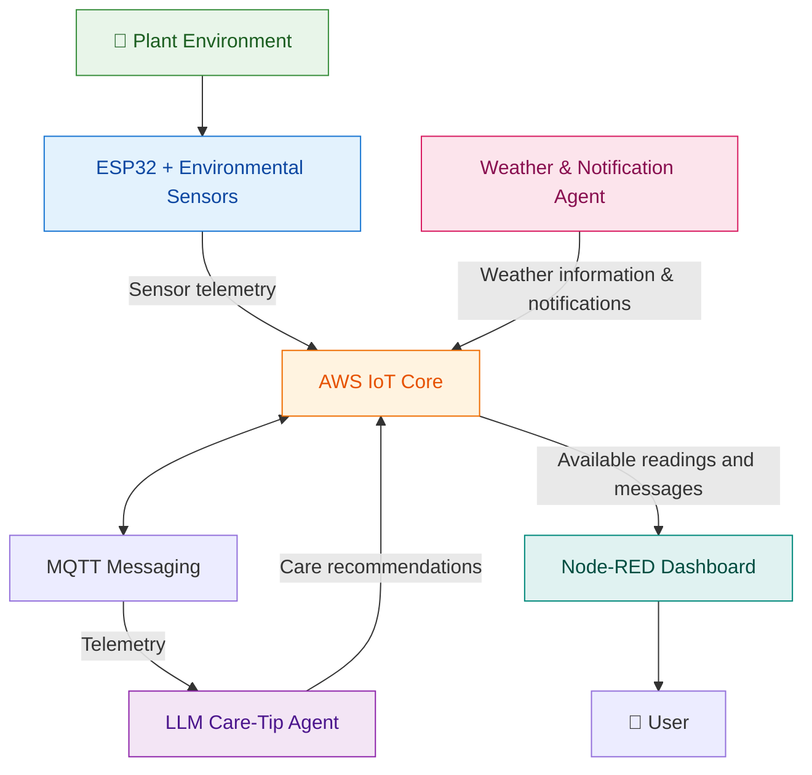
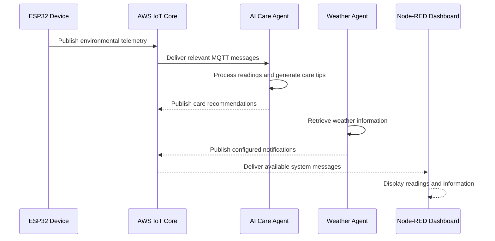

#  GreenPulse - Smart Agentic IoT Plant-Care System 🌱

**Intelligent Plant Monitoring and AI-Powered Care Recommendations**

GreenPulse is an IoT-based smart plant-care system that combines environmental sensing, cloud connectivity, AI-powered recommendations, weather information, and dashboard visualization. The system is designed to help users monitor plant conditions and receive meaningful plant-care insights using sensor data and intelligent software agents.

---

##  About the Project

Maintaining suitable growing conditions is important for healthy plant development. GreenPulse aims to make plant monitoring more accessible by integrating an ESP32-based device with cloud messaging, AI agents, and a centralized dashboard. The device collects environmental measurements and publishes sensor telemetry through MQTT. Backend components process relevant information, generate plant-care recommendations, and support weather-related notifications. The dashboard brings available sensor readings and system information together in one interface.

## ✨ Key Features

- 🌡️ **Real-Time Environmental Monitoring** — Collects temperature, humidity, soil-moisture, and light-level readings.
- 🤖 **AI-Powered Plant-Care Advice** — Uses a Large Language Model (LLM) to generate understandable care recommendations.
- ☁️ **Cloud-Based Communication** — Uses AWS IoT Core to support communication between IoT devices and backend components.
- 📡 **MQTT Messaging** — Transfers sensor telemetry, recommendations, and component status.
- 🌦️ **Weather-Aware Notifications** — Supports weather-related plant-care information through a dedicated agent.
- 📊 **Centralized Dashboard** — Uses Node-RED to visualize available system information.
- 🧩 **Modular Agent Architecture** — Separates system functionality into independent components.
- 🔬 **Testing Support** — Includes software components and sensor simulation tools for development and testing.

---

## 🏗️ System Architecture



*The diagram provides a high-level view of the system. Actual connections depend on the configured MQTT topics and implemented integrations.*

## 🔄 How the System Works



---

## 🧩 System Components

### Cloud MQTT and Data Management

Responsible for connecting the IoT device with AWS IoT Core and managing MQTT communication. It supports the transfer of sensor telemetry and messages between configured components.

### LLM Care-Tip Generation Agent

Processes relevant sensor readings and uses an LLM to generate context-aware plant-care recommendations. The agent communicates through configured MQTT topics.

### Weather and Notification Agent

Obtains weather information and supports notifications related to environmental conditions and plant care.

### Dashboard and Orchestration

Uses Node-RED to present available sensor readings, care recommendations, notifications, and system information through a centralized interface.

### ESP32-Based IoT Device

Collects environmental data using connected sensors and publishes readings to the cloud. The device can also provide local sensor feedback through its connected display and indicators, depending on the firmware configuration.

---

## 🛠️ Technology Stack

| Area | Technologies |
|---|---|
| IoT Hardware | ESP32, soil-moisture sensor, temperature and humidity sensor, light sensor |
| Embedded Development | Arduino IDE, C++ |
| Backend Development | Python |
| AI Framework | LangChain |
| Language Model Service | Groq API |
| Messaging Protocol | MQTT |
| Cloud IoT Platform | AWS IoT Core |
| Dashboard | Node-RED |
| Version Control | Git, GitHub |

Additional libraries and services may be used by individual components.

---

## 📡 MQTT Communication

GreenPulse uses MQTT topics to exchange information between its device and software components.

| Topic | Purpose |
|---|---|
| `greenpulse/GreenPulse01/telemetry` | Environmental sensor telemetry |
| `greenpulse/component2/care-tip` | Generated plant-care recommendations |
| `greenpulse/component2/status` | Care-agent status information |
| `greenpulse/GreenPulse01/query` | User-query input, if enabled |
| `greenpulse/component2/query-response` | Query responses, if enabled |
| `greenpulse/GreenPulse01/notification` | Weather or notification messages, if configured |
| `greenpulse/GreenPulse01/urgency` | Device indicator or urgency information, if configured |

*Topic names and message formats should be verified against the current source code and AWS IoT configuration.*

---

## 📁 Repository Structure

The repository is organized around the complete GreenPulse system and its individual components.

```text
GreenPulse/
├── README.md
├── .gitignore
├── hardware/
│   └── ESP32 firmware and sensor configuration
├── backend/
│   ├── C1/
│   │   └── Cloud MQTT and data management
│   ├── C2/
│   │   └── LLM care-tip generation agent
│   └── C3/
│       └── Weather and notification agent
└── dashboard/
    └── Node-RED dashboard and orchestration
```

*This is a suggested logical structure. The actual repository folders may differ depending on how the team organizes and uploads its source files.*

---

## ⚙️ Getting Started

GreenPulse consists of hardware, cloud configuration, backend agents, and a dashboard. Each component may require separate setup.

### Prerequisites

- Python and the dependencies required by the backend components.
- Arduino IDE and the required ESP32 libraries.
- AWS IoT Core configuration with suitable device permissions.
- MQTT topics configured for the relevant components.
- Required API credentials stored securely.
- Node-RED and the dashboard dependencies used by the project.

### Set Up the Backend

Clone the repository:

```bash
git clone https://github.com/dishani02/GreenPulse-Smart-Agentic-IoT-Plant-Care-Device-with-LLM-Backend.git
cd GreenPulse-Smart-Agentic-IoT-Plant-Care-Device-with-LLM-Backend
```

Navigate to the required component directory. For example, if the Component 2 source files are stored in `backend/C2/`:

```bash
cd backend/C2
```

Create and activate a Python virtual environment.

**Windows:**

```bash
python -m venv venv
venv\Scripts\activate
```

**Linux / macOS:**

```bash
python3 -m venv venv
source venv/bin/activate
```

Install the component dependencies:

```bash
pip install -r requirements.txt
```

Configure the environment variables and cloud settings required by that component. Run the appropriate Python entry point specified by its documentation.

### Set Up the ESP32 Device

1. Open the firmware project in Arduino IDE.
2. Install the required ESP32 board package and sensor libraries.
3. Configure Wi-Fi and AWS IoT connection settings securely.
4. Confirm the MQTT endpoint, topics, and device permissions.
5. Upload the firmware and check the device's serial output.

### Set Up the Dashboard

1. Install Node-RED and the required dashboard nodes.
2. Import the project's Node-RED flow when available.
3. Configure the required MQTT connection.
4. Confirm that the dashboard receives messages from the configured topics.
5. Open the dashboard using the URL configured by the Node-RED application.

*Exact commands and configuration details depend on the actual files included in each component.*

---

## 🔐 Security and Configuration

Protecting credentials and device access is essential for an IoT system.

- Never commit `.env` files, API keys, passwords, or private credentials.
- Never upload AWS private keys or sensitive device certificates.
- Keep local secrets in protected configuration files or environment variables.
- Apply least-privilege permissions to AWS IoT policies.
- Avoid publishing Wi-Fi passwords or personal account information.
- Exclude virtual environments, cache files, and temporary files from version control.
- Rotate credentials if they are accidentally exposed.

---

## 🧪 Testing and Validation

Testing should cover the complete data flow and individual component behavior.

- Sensor reading validation.
- MQTT connection and message delivery.
- Sensor payload format and handling of missing data.
- LLM recommendation generation.
- Weather information retrieval and notification handling.
- Dashboard visualization and message updates.
- Error handling when cloud services or APIs are unavailable.
- Integration testing between hardware, cloud services, agents, and dashboard.

---

## 👥 Project Team

**GreenPulse — Collaborative Project**

The project is developed collaboratively, with each team member responsible for a dedicated area of the system.

| Project Area | Main Responsibility |
|---|---|
| Cloud MQTT and Data Management | Cloud connectivity and message communication |
| LLM Care-Tip Generation | AI-powered plant-care recommendations |
| Weather and Notifications | Weather information and notification processing |
| Dashboard and Orchestration | Dashboard visualization and component coordination |

---

## 🎯 Project Objectives

- Improve access to plant environmental information.
- Generate useful plant-care recommendations from sensor readings.
- Integrate IoT devices with cloud-based messaging.
- Combine environmental data with AI-assisted insights.
- Provide a centralized interface for monitoring the system.
- Develop a modular and maintainable smart plant-care solution.

---

## 🌱 Future Improvements

Potential improvements include enhanced recommendation evaluation, support for additional sensors, improved historical data analysis, expanded plant profiles, and more comprehensive system monitoring.

These are possible future enhancements rather than claims about currently implemented features.

